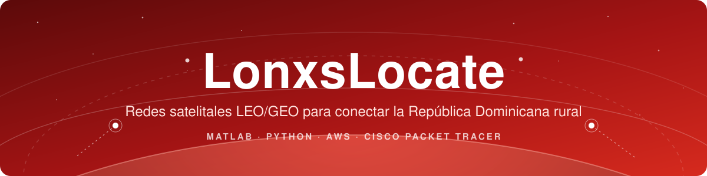
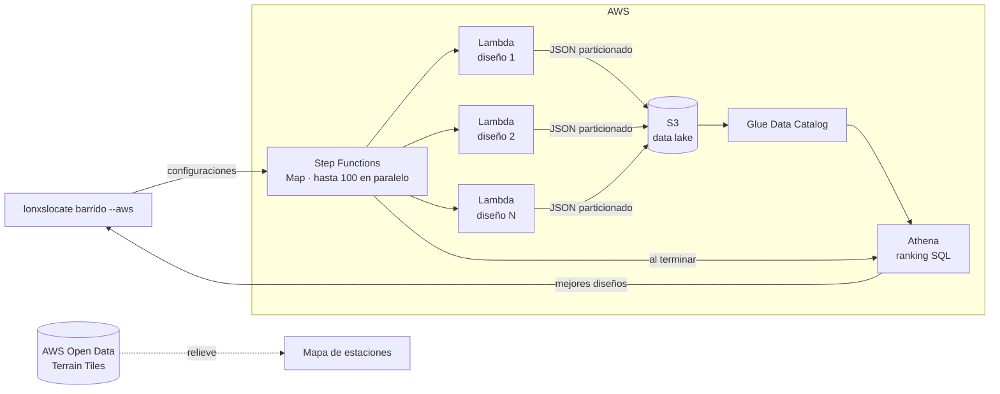

<div align="center">



<br>


[](https://github.com/Lonxs69/LonxsLocate/actions)


<br>


[](https://github.com/Lonxs69/LonxsLocate/stargazers)


**15 estaciones terrenas · 64 satélites bastan para cubrir el 100 % del país · ~4 ms de latencia vs. ~241 ms por GEO**

[Contexto](#contexto) · [Resultados](#resultados) · [AWS](#aws) · [Inicio rápido](#inicio-rapido) · [Simulaciones](#simulaciones) · [Arquitectura](docs/arquitectura.md) · [Fundamentos](docs/fundamentos.md)

</div>

---

<h2 align="center" id="contexto">🌎 Contexto</h2>

En la zona fronteriza (Pedernales, Elías Piña, Dajabón, Independencia), en Bahoruco, en la parte rural de Monte Plata o en las montañas de Constanza hay comunidades que todavía no tienen una conexión estable a internet. Llevar fibra a esos lugares es caro y lento, y en algunos casos imposible.

**LonxsLocate** diseña y analiza una red satelital que lleve conectividad a esas regiones de República Dominicana. Combina:

- 🛰️ **Constelación LEO** (órbita baja, 550–1 200 km): baja latencia, pero cada satélite pasa rápido sobre el territorio.
- 🌐 **Satélite GEO** (36 000 km): siempre visible y sirve de respaldo, aunque con latencia alta.
- 📡 **Estaciones terrenas**: 8 de subida (uplink) en ciudades con infraestructura (Santo Domingo, Santiago, La Romana, Puerto Plata, San Juan, Barahona, Higüey y San Francisco de Macorís) y 7 puntos de bajada (downlink) en zonas rurales.
- ☁️ **AWS**: barridos masivos de diseños en paralelo y un data lake consultable para elegir la constelación óptima.

La pregunta que responde el proyecto es: **¿cuántos satélites, en qué órbitas y con qué desfase hacen falta para que ninguna comunidad del país se quede sin servicio?**

<h2 align="center" id="resultados">📊 Resultados</h2>

<h3 align="center">Constelación mínima por altitud</h3>

Barrido de 90 diseños (6 a 20 planos × 4 a 12 satélites por plano × 3 altitudes), 24 h simuladas con rotación terrestre y elevación mínima de 10°. Se busca el diseño con **menos satélites** que mantenga **≥ 99.9 % de cobertura en las 15 estaciones**:

| Altitud | Diseño mínimo | Satélites | Cobertura mínima | Latencia al cénit |
|:---:|:---:|:---:|:---:|:---:|
| 550 km | 15 planos × 10 | 150 | **100 %** | 1.8 ms |
| 800 km | 10 planos × 10 | 100 | **100 %** | 2.7 ms |
| 1 200 km | 8 planos × 8 | **64** | **100 %** | 4.0 ms |

> El diseño inicial usaba 200 satélites. Según el barrido, **64 satélites a 1 200 km** bastan para mantener visibilidad continua (≥ 10° de elevación) sobre las 15 estaciones: **68 % menos satélites**. El costo es ~2 ms más de latencia y ~5.6 dB más de pérdida de trayecto. El modelo mide cobertura, no capacidad, así que el siguiente paso es el presupuesto de enlace del roadmap. Se reproduce con `python -m lonxslocate barrido`.

<h3 align="center">Enlace Santo Domingo → satélite → Pedernales</h3>

| | LEO 600 km | GEO 35 786 km |
|---|:---:|:---:|
| Latencia extremo a extremo | **4.1 ms** | 241 ms |
| Periodo orbital | 96.5 min | 23 h 56 min |
| Radio de huella (elev. ≥ 10°) | 1 761 km | 7 944 km |

<h3 align="center">Por qué importa el escalonamiento</h3>

Con 20 planos × 10 satélites escalonados, las 7 estaciones rurales tienen **100 % de cobertura** y 2.8 satélites visibles en promedio. Con una red **no escalonada** de 10 satélites (todos en fase) la cobertura cae al **~14 %**, con huecos de hasta 91 minutos. El GEO de respaldo tapa esos huecos, pero con 60 veces más latencia.

<h2 align="center" id="aws">☁️ El papel de AWS</h2>

AWS no se usa solo para "subir" el proyecto: resuelve el problema computacional central, que es **elegir la constelación**.

Cada diseño exige simular 24 h de movimiento orbital contra las 15 estaciones. Probar más combinaciones (inclinaciones, desfases Walker, elevaciones mínimas, nuevas provincias) hace crecer el número de diseños de forma multiplicativa, y en una laptop se vuelve lento. Como cada diseño es independiente, el problema es **perfectamente paralelizable**:



| Servicio | Rol en el proyecto |
|---|---|
| **Step Functions** | Reparte el barrido con un estado `Map` (hasta 100 diseños a la vez), reintenta con backoff si Lambda se satura y, al final, lanza la consulta de ranking. |
| **Lambda** (arm64, 1 vCPU) | Evalúa un diseño de constelación con el mismo motor de Python del proyecto, sin dependencias externas. |
| **S3** | Data lake de resultados particionado por barrido (`resultados/barrido=<id>/`). Privado, cifrado y con ciclo de vida. |
| **Glue + Athena** | Tabla con *partition projection* para consultar con SQL: diseños mínimos, frontera costo/cobertura, estación más crítica. Ver [`aws/athena/consultas.sql`](aws/athena/consultas.sql). |
| **AWS Open Data** | El relieve del mapa de estaciones viene de *Terrain Tiles*, el dataset abierto de elevación de AWS. |
| **IAM + OIDC** | GitHub Actions despliega sin llaves guardadas, con un rol de mínimo privilegio limitado a la rama `main`. |

Toda la infraestructura está en **Terraform** ([`aws/terraform`](aws/terraform)) y el CI valida su formato y su sintaxis en cada push. Un barrido de 90 diseños consume menos de 1 000 GB-segundo de Lambda, muy por debajo de la capa gratuita mensual (400 000 GB-segundo). Guía de despliegue: [`aws/README.md`](aws/README.md).

<h2 align="center" id="inicio-rapido">⚡ Inicio rápido</h2>

El motor de análisis está escrito en Python puro (sin dependencias):

```bash
git clone https://github.com/Lonxs69/LonxsLocate.git
cd LonxsLocate

python -m lonxslocate estaciones              # las 15 estaciones terrenas
python -m lonxslocate enlace                  # Santo Domingo → LEO → Pedernales
python -m lonxslocate huella 500 1200 35786   # periodo y cobertura por altitud
python -m lonxslocate cobertura --geo         # simulación de 24 h
python -m lonxslocate barrido                 # busca la constelación mínima (local)
```

```text
$ python -m lonxslocate enlace
Enlace Santo Domingo → satélite (600 km) → Pedernales

Tramo   Elevación  Distancia  Latencia  FSPL @ 12000 MHz
------  ---------  ---------  --------  ----------------
Subida  83.3°      604 km     2.01 ms   169.6 dB
Bajada  74.6°      620 km     2.07 ms   169.9 dB

Latencia extremo a extremo: 4.08 ms  (ida y vuelta: 8.17 ms)
Comparación con GEO en la misma longitud: 241.3 ms
```

<details>
<summary><b>Todas las opciones de <code>cobertura</code> y <code>barrido</code></b></summary>

| Opción | Por defecto | Descripción |
|---|---|---|
| `--planos` | 20 | Planos orbitales |
| `--sats` | 10 | Satélites por plano |
| `--altitud` | 629 | Altitud en km |
| `--inclinacion` | 98 | Grados (98° ≈ órbita polar heliosíncrona) |
| `--horas` / `--paso` | 24 / 60 | Duración y resolución de la simulación (h / s) |
| `--elevacion` | 10 | Elevación mínima para considerar visible un satélite |
| `--tipo` | todas | `uplink` o `downlink` |
| `--geo` | no | Agrega un GEO de respaldo sobre 70° O |
| `--no-escalonada` | no | Todos los planos en fase |
| `--sin-rotacion` | no | Tierra fija, igual que en los scripts de MATLAB |
| `--csv` | — | Exporta los resultados a un archivo CSV |

`barrido`: `--objetivo` (cobertura mínima, 99.9 %), `--procesos`, `--top`, `--json` y `--aws <state-machine-arn>` para ejecutarlo en la nube (`pip install ".[aws]"`).

Opción global: `--estaciones otro.csv` para analizar cualquier otro país o región con el mismo formato que [`data/estaciones.csv`](data/estaciones.csv).

</details>

Atajos con `make`: `make test`, `make demo`, `make cobertura`, `make barrido`, `make tf-validar` y `make imagenes`.

<h2 align="center" id="simulaciones">🛰️ Simulaciones</h2>

<h3 align="center">1. Universe Sandbox: modelo orbital</h3>

El primer paso fue modelar las órbitas GEO y LEO en Universe Sandbox, ubicar los satélites para maximizar la cobertura sobre las regiones objetivo y detectar huecos.

<p align="center">
  <br>
  <sub>Red satelital sin rotación de la Tierra</sub>
</p>

<p align="center">
  <br>
  <sub>Simulación con la rotación de la Tierra dentro del sistema solar</sub>
</p>

Los videos completos están en [`simulaciones/universe-sandbox/`](simulaciones/universe-sandbox).

<h3 align="center">2. MATLAB: Satellite Communications Toolbox</h3>

| Script | Qué hace |
|---|---|
| [`Satellite_Connection_Simulation_Chart.m`](matlab/Satellite_Connection_Simulation_Chart.m) | Enlace Santo Domingo (estación base) → satélite LEO → Pedernales (bajada) en 3D |
| [`ModulationofPackets.m`](matlab/ModulationofPackets.m) | Modulación AM de subida y bajada, y transmisión de paquetes con fragmentación |
| [`Non_Step_Satellite_Network.m`](matlab/Non_Step_Satellite_Network.m) | Red LEO sin desfase entre satélites + GEO de respaldo |
| [`FullSatelliteSimulation.m`](matlab/FullSatelliteSimulation.m) | Simulación completa: 200 LEO escalonados + GEO + 15 estaciones |
| [`cargar_estaciones.m`](matlab/cargar_estaciones.m) | Carga las estaciones desde `data/estaciones.csv` |

<h4 align="center">Enlace Santo Domingo → LEO → Pedernales</h4>

Pedernales, en la frontera sur, es una de las provincias del país con más necesidad de conectividad. El script dibuja la Tierra, la órbita y los dos tramos del enlace.

<p align="center">
  
</p>

<h4 align="center">Modulación y transmisión de paquetes</h4>

Simula el envío de paquetes desde las estaciones base al satélite. Se pueden ajustar la cantidad de paquetes y la latencia; con latencia alta, los paquetes se fragmentan antes de transmitirse, como pasa en un enlace satelital real.

<p align="center">
  
</p>

<h4 align="center">Red no escalonada</h4>

Todos los satélites LEO arrancan sin desfase y un GEO garantiza presencia constante, pero con hasta 600 ms de latencia. Es un diseño frágil: una falla en la constelación LEO afecta toda la red.

<p align="center">
  
</p>

<h4 align="center">Simulación completa con escalonamiento</h4>

Ahora sí con desfase entre planos, para que siempre haya al menos un satélite LEO sobre el país. El número de órbitas y de satélites por órbita es configurable, y las estaciones se cargan desde `data/estaciones.csv`.

<p align="center">
  <br>
  <sub>Las 15 estaciones terrenas y la traza de dos satélites de la constelación pasando sobre la isla</sub>
</p>

<p align="center">
  <br>
  <sub>Visor del movimiento de los satélites en tiempo real</sub>
</p>

<h3 align="center">3. Cisco Packet Tracer: red de acceso</h3>

Como Packet Tracer no tiene satélites, el satélite se representa con una **tablet**. Esta se conecta a una **estación base** con un **access point** para la subida, y una **antena 3G/4G** distribuye la bajada. La estación base está en **Barahona** y el downlink en **Pedernales**, que reparte el servicio a **Pedernales**, **Oviedo** y **Juancho**. El mismo esquema se puede replicar en cualquier provincia.

<p align="center">
  
</p>

Archivo: [`simulaciones/cisco/SimulacionCisco.pkt`](simulaciones/cisco/SimulacionCisco.pkt)

<h2 align="center" id="estructura">📁 Estructura</h2>

```
LonxsLocate/
├── lonxslocate/          # motor de análisis en Python (CLI)
├── aws/
│   ├── lambda/           # handler que evalúa un diseño
│   ├── terraform/        # S3, Lambda, Step Functions, Glue, Athena, OIDC
│   └── athena/           # consultas SQL de ejemplo
├── matlab/               # scripts de Satellite Communications Toolbox
├── data/estaciones.csv   # fuente única de coordenadas
├── simulaciones/
│   ├── cisco/            # Packet Tracer
│   └── universe-sandbox/ # videos
├── docs/                 # arquitectura, fundamentos e imágenes
├── scripts/              # generador de las figuras del README
└── tests/
```

<h2 align="center" id="roadmap">🗺️ Roadmap</h2>

- [x] Modelo orbital en Universe Sandbox
- [x] Simulaciones en MATLAB (enlace, modulación, red completa)
- [x] Red de acceso en Cisco Packet Tracer
- [x] Motor de análisis en Python con rotación terrestre
- [x] Simulación de cobertura temporal por estación
- [x] Barrido de diseños serverless en AWS con ranking en Athena
- [ ] Máscara de horizonte por relieve (Terrain Tiles) para estaciones en valles como Constanza
- [ ] Presupuesto de enlace completo (ganancia de antenas, EIRP, C/N)
- [ ] Atenuación por lluvia (ITU-R P.618), clave en temporada ciclónica
- [ ] Dashboard de resultados de barridos
- [ ] Enlaces entre satélites (ISL)

<h2 align="center" id="recomendaciones">💡 Recomendaciones</h2>

- **Escalabilidad:** antes de llevar un diseño a MATLAB, filtra las opciones con `barrido` (local o en AWS).
- **Latencia:** el GEO sirve de respaldo, no como enlace principal en aplicaciones en tiempo real.
- **Adaptabilidad:** agrega cualquier provincia en `data/estaciones.csv`; el análisis se aplica a cualquier zona desconectada del mundo.
- **Escenarios reales:** ajusta redundancia, pérdida de paquetes o fragmentación para acercar la simulación a condiciones reales.

<h2 align="center" id="autor">👤 Autor</h2>

<p align="center">
  <b>Junior De León</b> · DevOps · <a href="https://github.com/Lonxs69">@Lonxs69</a><br>
  <sub>Distribuido bajo licencia <a href="LICENSE">MIT</a>.</sub>
</p>
