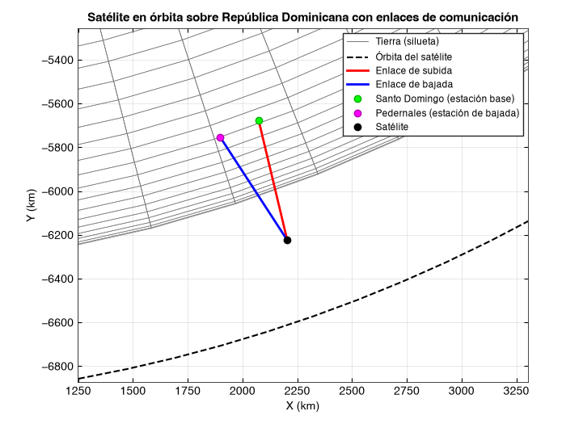
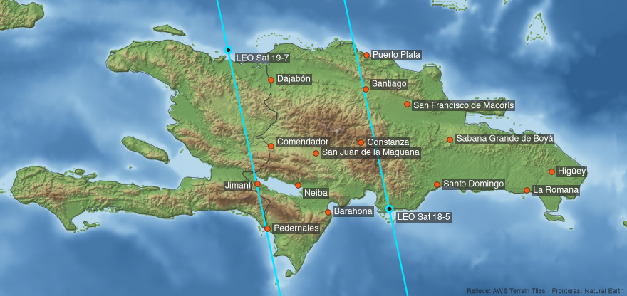
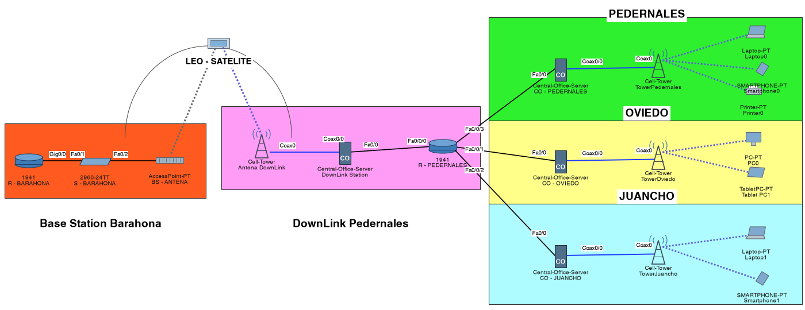

<div align="center">


[](https://github.com/Lonxs69/lonxsLocate/actions)

**200 satélites LEO · 1 GEO · 15 estaciones terrenas · ~5 ms de latencia vs. ~240 ms por GEO**

[Contexto](#-contexto) · [Resultados](#-resultados) · [Inicio rápido](#-inicio-rápido) · [Simulaciones](#-simulaciones) · [Arquitectura](docs/arquitectura.md) · [Fundamentos](docs/fundamentos.md)

</div>

---

## 🌎 Contexto

En la zona fronteriza (Pedernales, Elías Piña, Dajabón, Independencia), en Bahoruco, en la parte rural de Monte Plata o en las montañas de Constanza hay comunidades que todavía no tienen una conexión estable a internet. Llevar fibra a esos lugares es caro y lento, y en algunos casos imposible.

**lonxsLocate** diseña y analiza una red satelital que lleve conectividad a esas regiones de República Dominicana. Combina:

- 🛰️ **Constelación LEO** (órbita baja, ~600 km): baja latencia, pero cada satélite pasa rápido sobre el territorio.
- 🌐 **Satélite GEO** (36 000 km): siempre visible y sirve de respaldo, aunque con latencia alta.
- 📡 **Estaciones terrenas**: 8 de subida (uplink) en ciudades con infraestructura (Santo Domingo, Santiago, La Romana, Puerto Plata, San Juan, Barahona, Higüey y San Francisco de Macorís) y 7 puntos de bajada (downlink) en zonas rurales.

La pregunta que responde el proyecto es: **¿cuántos satélites, en qué órbitas y con qué desfase hacen falta para que ninguna comunidad del país se quede sin servicio?**

## 📊 Resultados

Constelación Walker de 20 planos × 10 satélites a 629 km y 98° de inclinación, simulada durante 24 h con la rotación de la Tierra:

| Estación downlink | Provincia | Cobertura | Hueco máximo | Satélites visibles (prom.) |
|---|---|:---:|:---:|:---:|
| Pedernales | Pedernales | **100 %** | 0 min | 2.8 |
| Comendador | Elías Piña | **100 %** | 0 min | 2.8 |
| Dajabón | Dajabón | **100 %** | 0 min | 2.8 |
| Jimaní | Independencia | **100 %** | 0 min | 2.8 |
| Neiba | Bahoruco | **100 %** | 0 min | 2.8 |
| Sabana Grande de Boyá | Monte Plata | **100 %** | 0 min | 2.8 |
| Constanza | La Vega | **100 %** | 0 min | 2.8 |

Comparativa del enlace **Santo Domingo → satélite → Pedernales**:

| | LEO 600 km | GEO 35 786 km |
|---|:---:|:---:|
| Latencia extremo a extremo | **4.1 ms** | 241 ms |
| Periodo orbital | 96.5 min | 23 h 56 min |
| Radio de huella (elev. ≥ 10°) | 1 761 km | 7 944 km |

> Con una red **no escalonada** de 10 satélites (un satélite por plano, todos en fase) la cobertura cae al ~14 % y aparecen huecos de hasta 91 minutos. Agregar el GEO de respaldo tapa esos huecos, pero con 60 veces más latencia. El escalonamiento entre planos es lo que hace viable la red.

## ⚡ Inicio rápido

La herramienta de análisis está escrita en Python puro (sin dependencias):

```bash
git clone https://github.com/Lonxs69/lonxsLocate.git
cd lonxsLocate

python -m lonxslocate estaciones              # las 15 estaciones terrenas
python -m lonxslocate enlace                  # Santo Domingo → LEO → Pedernales
python -m lonxslocate huella 500 1200 35786   # periodo y cobertura por altitud
python -m lonxslocate cobertura --geo         # simulación de 24 h
```

```text
$ python -m lonxslocate enlace
Enlace Santo Domingo → satélite (600 km) → Pedernales

Tramo   Elevación  Distancia  Latencia  FSPL @ 12000 MHz
------  ---------  ---------  --------  ----------------
Subida  83.3°      604 km     2.01 ms   169.6 dB
Bajada  74.6°      620 km     2.07 ms   169.9 dB

Latencia extremo a extremo: 4.08 ms  (ida y vuelta: 8.17 ms)
Comparación con GEO en la misma longitud: 241.3 ms
```

<details>
<summary><b>Todas las opciones de <code>cobertura</code></b></summary>

| Opción | Por defecto | Descripción |
|---|---|---|
| `--planos` | 20 | Planos orbitales |
| `--sats` | 10 | Satélites por plano |
| `--altitud` | 629 | Altitud en km |
| `--inclinacion` | 98 | Grados (98° ≈ órbita polar heliosíncrona) |
| `--horas` / `--paso` | 24 / 60 | Duración y resolución de la simulación (h / s) |
| `--elevacion` | 10 | Elevación mínima para considerar visible un satélite |
| `--tipo` | todas | `uplink` o `downlink` |
| `--geo` | no | Agrega un GEO de respaldo sobre 70° O |
| `--no-escalonada` | no | Todos los planos en fase |
| `--sin-rotacion` | no | Tierra fija, igual que en los scripts de MATLAB |
| `--csv` | — | Exporta los resultados a un archivo CSV |

Opción global: `--estaciones otro.csv` para analizar cualquier otro país o región con el mismo formato que [`data/estaciones.csv`](data/estaciones.csv).

</details>

Atajos con `make`: `make test`, `make demo`, `make cobertura` y `make imagenes` (regenera las figuras del README a partir de los datos).

## 🛰️ Simulaciones

### 1. Universe Sandbox: modelo orbital

El primer paso fue modelar las órbitas GEO y LEO en Universe Sandbox, ubicar los satélites para maximizar la cobertura sobre las regiones objetivo y detectar huecos.

<p align="center">
  <br>
  <sub>Red satelital sin rotación de la Tierra</sub>
</p>

<p align="center">
  <br>
  <sub>Simulación con la rotación de la Tierra dentro del sistema solar</sub>
</p>

Los videos completos están en [`simulaciones/universe-sandbox/`](simulaciones/universe-sandbox).

### 2. MATLAB: Satellite Communications Toolbox

| Script | Qué hace |
|---|---|
| [`Satellite_Connection_Simulation_Chart.m`](matlab/Satellite_Connection_Simulation_Chart.m) | Enlace Santo Domingo (estación base) → satélite LEO → Pedernales (bajada) en 3D |
| [`ModulationofPackets.m`](matlab/ModulationofPackets.m) | Modulación AM de subida y bajada y transmisión de paquetes con latencia |
| [`Non_Step_Satellite_Network.m`](matlab/Non_Step_Satellite_Network.m) | Red LEO sin desfase entre satélites + GEO de respaldo |
| [`FullSatelliteSimulation.m`](matlab/FullSatelliteSimulation.m) | Simulación completa: 200 LEO escalonados + GEO + 15 estaciones |
| [`cargar_estaciones.m`](matlab/cargar_estaciones.m) | Carga las estaciones desde `data/estaciones.csv` |

#### Enlace Santo Domingo → LEO → Pedernales

Pedernales, en la frontera sur, es una de las provincias del país con más necesidad de conectividad. El script dibuja la Tierra, la órbita y los dos tramos del enlace.

<p align="center">
  
</p>

#### Modulación y transmisión de paquetes

Simula el envío de paquetes desde las estaciones base al satélite. Se pueden ajustar la cantidad de paquetes y la latencia; con latencia alta, los paquetes se fragmentan antes de transmitirse, como pasa en un enlace satelital real.

<p align="center">
  
</p>

#### Red no escalonada

Todos los satélites LEO arrancan sin desfase y un GEO garantiza presencia constante, pero con hasta 600 ms de latencia. Es un diseño frágil: una falla en la constelación LEO afecta toda la red.

<p align="center">
  
</p>

#### Simulación completa con escalonamiento

Ahora sí con desfase entre planos, para que siempre haya al menos un satélite LEO sobre el país. El número de órbitas y de satélites por órbita es configurable, y las estaciones se cargan desde `data/estaciones.csv`.

<p align="center">
  <br>
  <sub>Las 15 estaciones terrenas y la traza de dos satélites de la constelación pasando sobre la isla</sub>
</p>

<p align="center">
  <br>
  <sub>Visor del movimiento de los satélites en tiempo real</sub>
</p>

### 3. Cisco Packet Tracer: red de acceso

Como Packet Tracer no tiene satélites, el satélite se representa con una **tablet**. Esta se conecta a una **estación base** con un **access point** para la subida, y una **antena 3G/4G** distribuye la bajada. La estación base está en **Barahona** y el downlink en **Pedernales**, que reparte el servicio a **Pedernales**, **Oviedo** y **Juancho**. El mismo esquema se puede replicar en cualquier provincia.

<p align="center">
  
</p>

Archivo: [`simulaciones/cisco/SimulacionCisco.pkt`](simulaciones/cisco/SimulacionCisco.pkt)

## 📁 Estructura

```
lonxsLocate/
├── lonxslocate/          # herramienta de análisis en Python
├── matlab/               # scripts de Satellite Communications Toolbox
├── data/estaciones.csv   # fuente única de coordenadas
├── simulaciones/
│   ├── cisco/            # Packet Tracer
│   └── universe-sandbox/ # videos
├── docs/                 # arquitectura, fundamentos e imágenes
├── scripts/              # generador de las imágenes del README
└── tests/
```

## 🗺️ Roadmap

- [x] Modelo orbital en Universe Sandbox
- [x] Simulaciones en MATLAB (enlace, modulación, red completa)
- [x] Red de acceso en Cisco Packet Tracer
- [x] Herramienta de análisis en Python con rotación terrestre
- [x] Simulación de cobertura temporal por estación
- [ ] Presupuesto de enlace completo (ganancia de antenas, EIRP, C/N)
- [ ] Atenuación por lluvia (ITU-R P.618), clave en Chocó y Amazonas
- [ ] Mapa interactivo de cobertura
- [ ] Enlaces entre satélites (ISL)

## 💡 Recomendaciones

- **Escalabilidad:** para redes grandes, varía planos y satélites por plano con `cobertura` antes de llevarlo a MATLAB.
- **Latencia:** el GEO sirve de respaldo, no como enlace principal en aplicaciones en tiempo real.
- **Adaptabilidad:** agrega cualquier región en `data/estaciones.csv`; el análisis se aplica a cualquier zona desconectada del mundo.
- **Escenarios reales:** ajusta redundancia, pérdida de paquetes o fragmentación para acercar la simulación a condiciones reales.

## 👤 Autor

**Junior De León** · [@Lonxs69](https://github.com/Lonxs69)

Distribuido bajo licencia [MIT](LICENSE).


