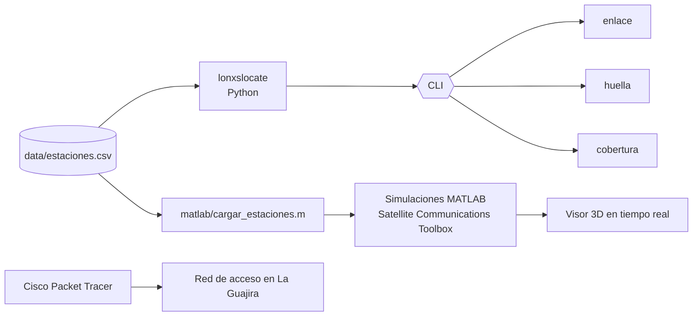

# Arquitectura



## Capas

| Capa | Herramienta | Qué resuelve |
|---|---|---|
| Concepto orbital | Universe Sandbox | Validar visualmente las órbitas GEO y LEO |
| Diseño de constelación | MATLAB + `lonxslocate cobertura` | Cuántos planos y satélites hacen falta para que nunca quede Colombia sin servicio |
| Enlace | MATLAB + `lonxslocate enlace` | Geometría, latencia y pérdidas de cada tramo |
| Señal | `ModulationofPackets.m` | Modulación AM de subida y bajada, y transmisión de paquetes con latencia |
| Red de acceso | Cisco Packet Tracer | Última milla: estación base → AP → antena 3G/4G → usuarios |

## Módulos de Python

```
lonxslocate/
├── orbita.py      # Kepler, posición ECI, constelaciones Walker y GEO
├── enlace.py      # estaciones, elevación, distancia, latencia, FSPL, huella
├── cobertura.py   # simulación temporal de visibilidad por estación
└── cli.py         # comandos estaciones / enlace / huella / cobertura
```

Solo usa la librería estándar, así que funciona en cualquier Python ≥ 3.9 sin instalar nada.

## Fuente única de datos

Las coordenadas viven en `data/estaciones.csv`. Antes cada script de MATLAB repetía las mismas coordenadas a mano, y Riohacha tenía valores distintos en dos scripts. Ahora Python y MATLAB leen el mismo archivo.
