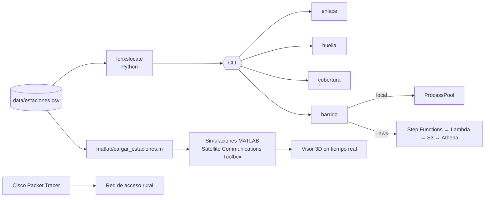

# Arquitectura



## Capas

| Capa | Herramienta | Qué resuelve |
|---|---|---|
| Concepto orbital | Universe Sandbox | Validar visualmente las órbitas GEO y LEO |
| Diseño de constelación | MATLAB + `lonxslocate cobertura` | Cuántos planos y satélites hacen falta para que ninguna provincia quede sin servicio |
| Enlace | MATLAB + `lonxslocate enlace` | Geometría, latencia y pérdidas de cada tramo |
| Señal | `ModulationofPackets.m` | Modulación AM de subida y bajada, y transmisión de paquetes con latencia |
| Red de acceso | Cisco Packet Tracer | Última milla: estación base → AP → antena 3G/4G → usuarios |
| Optimización | `lonxslocate barrido` + AWS | Probar decenas o cientos de diseños en paralelo y quedarse con el más barato que cumple la cobertura |

## Módulos de Python

```
lonxslocate/
├── orbita.py      # Kepler, posición ECI, constelaciones Walker y GEO
├── enlace.py      # estaciones, elevación, distancia, latencia, FSPL, huella
├── cobertura.py   # simulación temporal de visibilidad por estación
├── barrido.py     # grilla de diseños, evaluación y ranking
├── nube.py        # lanza el barrido en AWS y lee el ranking de Athena (boto3 opcional)
└── cli.py         # comandos estaciones / enlace / huella / cobertura / barrido
```

El núcleo solo usa la librería estándar, así que funciona en cualquier Python ≥ 3.9 sin instalar nada. Ese mismo código es el que corre dentro de AWS Lambda.

## En la nube

`evaluar_configuracion()` es una función pura: recibe un diseño y devuelve sus métricas. Eso permite ejecutarla igual en un proceso local o en una Lambda. Step Functions reparte la grilla con un estado `Map`, cada Lambda escribe una línea JSON en S3 bajo `resultados/barrido=<id>/` y, al terminar, Step Functions ejecuta en Athena la consulta que ordena los diseños válidos por cantidad de satélites. Detalles y seguridad en [`aws/README.md`](../aws/README.md).

## Fuente única de datos

Las coordenadas viven en `data/estaciones.csv`. Antes cada script de MATLAB repetía las mismas coordenadas a mano y era fácil que dos scripts quedaran con valores distintos. Ahora Python y MATLAB leen el mismo archivo, y con `--estaciones` se puede analizar cualquier otro país sin tocar el código.
